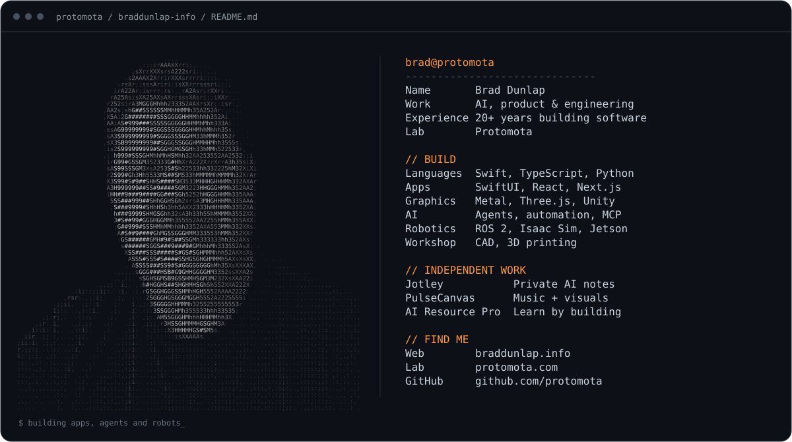

<a href="https://www.braddunlap.info"></a>

[Website](https://www.braddunlap.info) · [Protomota](https://protomota.com) · [LinkedIn](https://www.linkedin.com/in/bradley-dunlap/) · [YouTube](https://www.youtube.com/@protomota) · [Newsletter](https://newsletter.protomota.com)

I build software, automate the work around it, and make robots do things in the physical world. This is the source for my personal site: experience, selected work, and the things I build through Protomota.

The portrait is made from ASCII characters, rendered as a self-contained SVG so the spacing and colors survive GitHub's light and dark themes. [Plain-text portrait](docs/portrait.txt) · [Portrait generator](tools/readme/build_ascii.py)

### Run locally

Use Node.js 22 LTS or newer.

```bash
npm ci
npm run dev -- -p 3004
```

Open [localhost:3004](http://localhost:3004). The site runs without credentials; the contact form stays hidden until a Resend API key is configured.

```bash
npm run build
npm run start -- -p 3004
```

The production build also runs TypeScript checks. There is no separate test runner or linter configured.

### What's inside

| File | Purpose |
| --- | --- |
| `lib/content.ts` | Shared copy, experience, projects, and links |
| `app/page.tsx` | Server-rendered page |
| `app/CareerScene.tsx` | Interactive Three.js career timeline |
| `app/ReelPlayer.tsx` | Click-to-load HLS reel with a YouTube fallback |
| `app/ResumePicker.tsx` | PDF, Word, and Markdown résumé downloads |
| `app/api/contact/route.ts` | Server-side email through Resend |
| `app/globals.css` | Layout, design tokens, and scroll animations |
| `lib/newsletter.ts` | Server-side newsletter RSS feed |
| `lib/seo.ts` | Structured data and shared search metadata |
| `public/` | Site images, project artwork, and résumé files |

Built with Next.js App Router, TypeScript, React, Three.js, and CSS. The newsletter refreshes hourly. The career timeline respects reduced motion and falls back when WebGL2 is unavailable.

### Optional contact form

Copy `.env.example` to `.env.local` and configure your own Resend account and verified sender domain. Environment files stay out of Git. The Turnstile site key is public; the Resend and Turnstile secret keys belong only on the server.

| Variable | Purpose |
| --- | --- |
| `RESEND_API_KEY` | Enables the contact form and sends email |
| `CONTACT_TO_EMAIL` | Recipient inbox; defaults to the public business email |
| `CONTACT_FROM_EMAIL` | Verified notification sender |
| `CONTACT_REPLY_FROM_EMAIL` | Verified thank-you sender |
| `NEXT_PUBLIC_TURNSTILE_SITE_KEY` | Optional browser challenge; set together with its secret |
| `TURNSTILE_SECRET_KEY` | Server-side challenge verification |

Set build-time variables before building. Turnstile is optional in this implementation; enable both keys before accepting public submissions on your own deployment.

### Make it yours

Start with `lib/content.ts`, then replace the résumé downloads, portraits, project images, and branding. Update `lib/seo.ts`, metadata and analytics in `app/layout.tsx`, email templates, newsletter URL, and reel URLs. The analytics and search-verification IDs already exposed by the public site are identifiers, not credentials; use your own on a fork.

To regenerate the README portrait, install Pillow in a Python virtual environment and run `python tools/readme/build_ascii.py` from the repository root. It reads `public/img/brad.jpg` and writes the SVG and plain text to `docs/` without calling an external service.

### License

The application code is available under the [MIT License](LICENSE). My résumé, written biography, portrait, logos, project screenshots, and other media are excluded; see [ASSETS.md](ASSETS.md). Use the code to build your own site with your own identity and assets.
